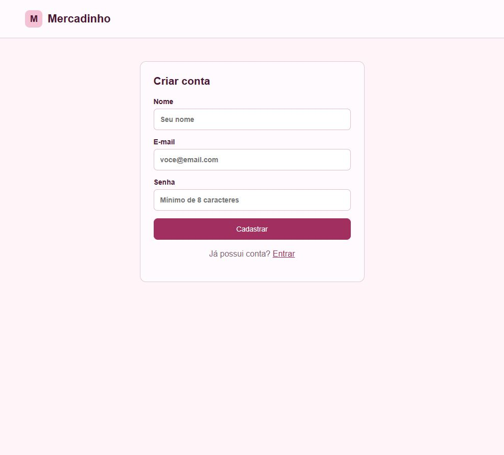
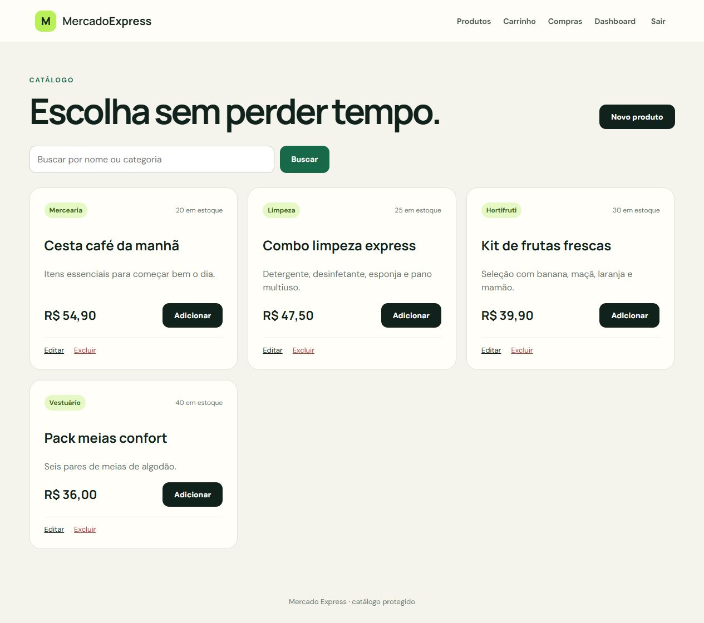
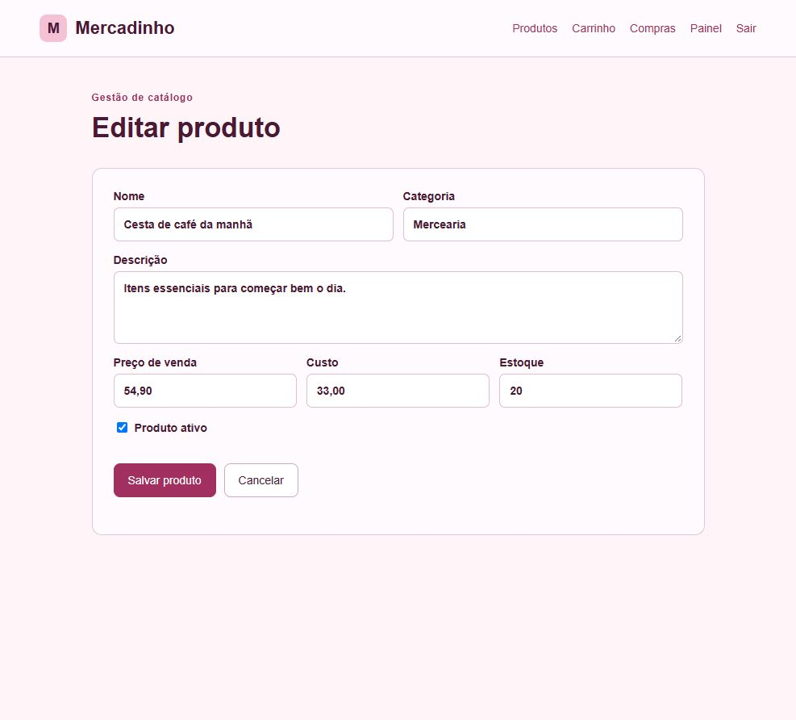
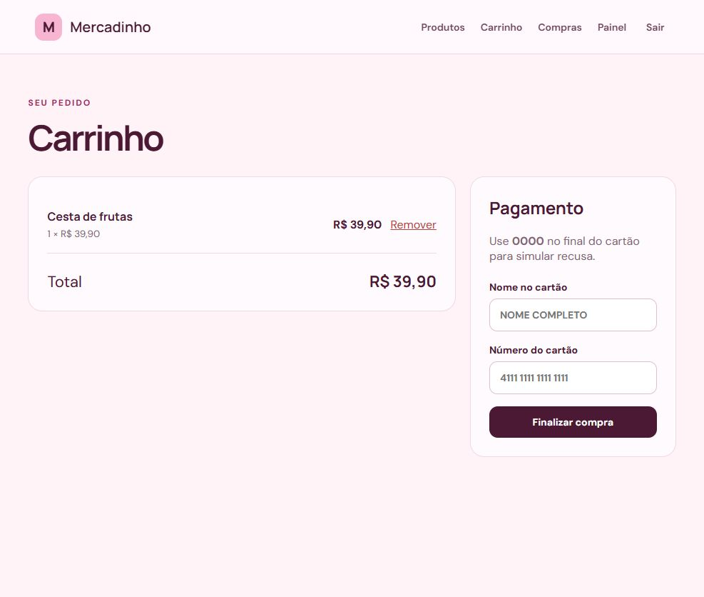
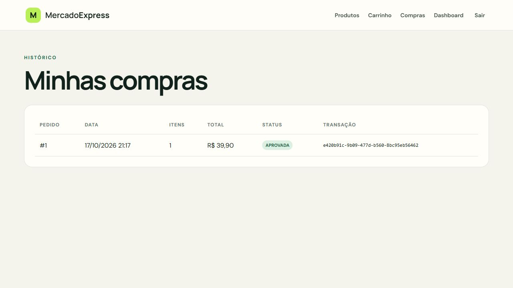
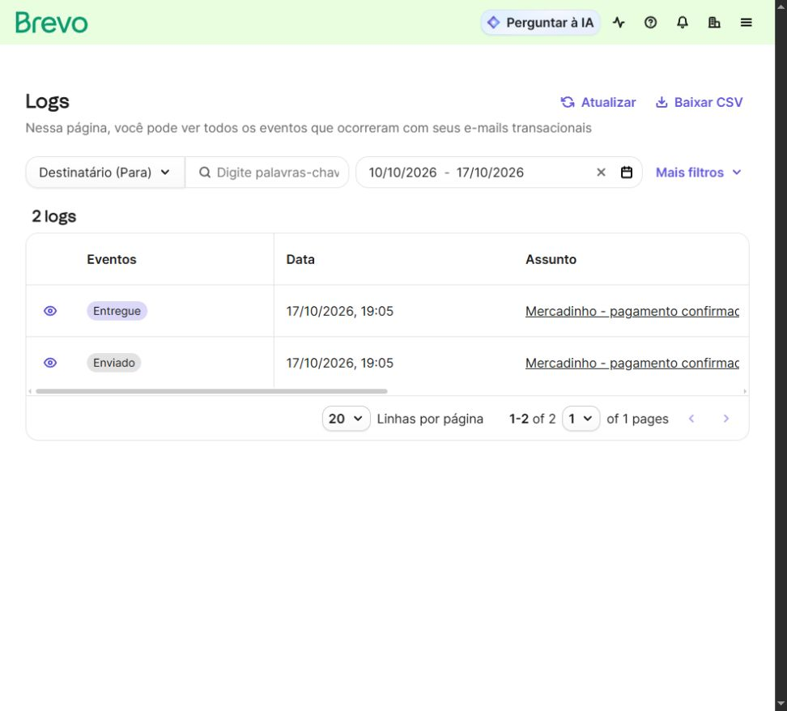
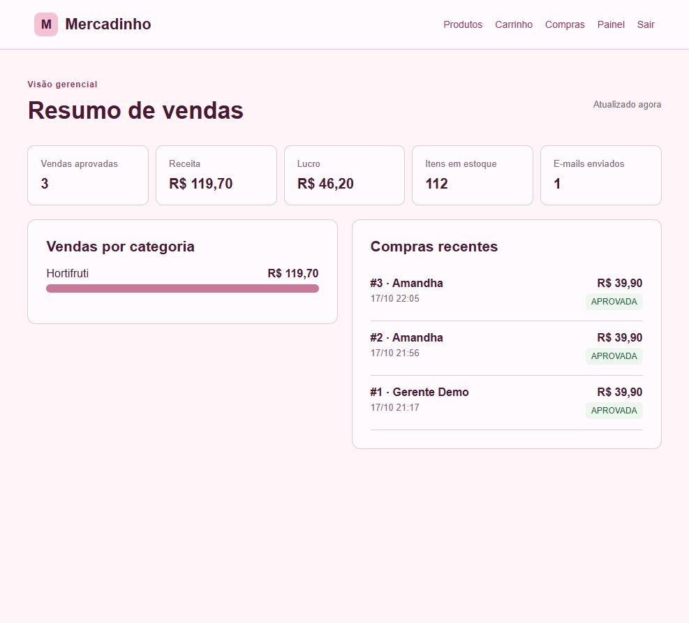

# Mercadinho

Projeto das partes 1 e 2 da CP5 de Java Advanced: uma loja online com controle de acesso, cadastro de produtos, carrinho, pagamento simulado e confirmação por e-mail.

**Aluna:** Amandha Yumi Toyota Artulino

**RM:** 563549 · **Turma:** 2TDSPO · **Curso:** Análise e Desenvolvimento de Sistemas

**IDE utilizada:** IntelliJ IDEA

- [Aplicação no Render](https://mercado-express-cp5-rm563549.onrender.com/)
- [Repositório no GitHub](https://github.com/AmandhaYumi/Cp-Java)
- [Vídeo](youtube.com/watch?v=2-JJ8smLS0s&feature=youtu.be)
  
## Sobre o projeto

O Mercadinho permite consultar produtos, criar uma conta e realizar compras com pagamento fictício. O gerente pode cadastrar, editar e desativar produtos, além de acompanhar os resultados da loja. As informações são persistidas no PostgreSQL.

O projeto utiliza Java 21, Maven, Spring Boot 4.1.1, Spring MVC, Thymeleaf, Spring Security, Spring Data JPA, Validation, Lombok, PostgreSQL e RabbitMQ. O envio de e-mail utiliza Java Mail e o SMTP do Brevo no deploy. O H2 é usado nos testes e no perfil de demonstração.

### Dependências do Spring Initializr


## Páginas e funcionalidades

### Página inicial

A página `index.html` apresenta a loja e os links para cadastro e login. As demais telas exigem autenticação, conforme as permissões de cada perfil.


### Login e cadastro

A tela de login foi criada com Thymeleaf, substituindo a página padrão do Spring Security. O formulário envia `email` e `password` para `/login`. Após a autenticação, o usuário é direcionado ao catálogo em `/products`.


O link **Cadastre-se** abre `/register`. O cadastro valida nome, e-mail e senha, verifica e-mail duplicado, codifica a senha com BCrypt e salva a conta em `TDS_USERS_MERCADO`. Novas contas recebem o perfil `CLIENTE`.



As regras estão em [SecurityConfig.java](src/main/java/br/com/mercadoexpress/mercadoexpress/config/SecurityConfig.java). A autenticação das telas usa sessão; os formulários têm proteção CSRF. A API aceita Basic Auth para testes no Postman. O cadastro e a consulta dos usuários são implementados em [AccountService.java](src/main/java/br/com/mercadoexpress/mercadoexpress/service/AccountService.java).

| Perfil | Permissões |
|---|---|
| CLIENTE | Consultar produtos, comprar e visualizar suas próprias compras |
| GERENTE | Recursos do cliente, CRUD de produtos e painel gerencial |

Por exemplo, um cliente que tenta acessar `/admin/dashboard` recebe HTTP 403. Os botões de edição e exclusão aparecem somente para o gerente, e as mesmas restrições são verificadas no servidor.

### Produtos e CRUD

O catálogo consulta o PostgreSQL e permite buscar por nome ou categoria. Cada produto possui nome, descrição, categoria, preço, custo, estoque e indicação de ativo.



O gerente utiliza **Novo produto** para cadastrar e **Editar** para alterar os dados. **Excluir** desativa o produto sem apagar o histórico das compras. A validação impede preço inválido e estoque negativo.



| Operação | Tela/rota MVC | Rota REST |
|---|---|---|
| Criar | `GET /products/new` e `POST /products` | `POST /api/products` |
| Consultar | `GET /products` | `GET /api/products` |
| Editar | `GET /products/{id}/edit` e `POST /products/{id}` | `PUT /api/products/{id}` |
| Excluir logicamente | `POST /products/{id}/delete` | `DELETE /api/products/{id}` |

### Carrinho e compras

O cliente adiciona os produtos ao carrinho e confere o total antes de finalizar. O checkout verifica e reserva o estoque, registra a compra como `PENDENTE` e inicia o processamento do pagamento.



O histórico mostra apenas as compras do usuário autenticado, com valor, status e identificador da transação. A compra pode ficar `APROVADA` ou `RECUSADA`. Em uma recusa, o estoque reservado é devolvido.



**Exemplo de pagamento fictício:** titular `CLIENTE TESTE` e cartão `4111111111111111`. Para simular recusa, use um número com 13 a 19 dígitos terminado em `0000`. O Banco Tranquilo deste projeto é um simulador educacional: não há cobrança real e não devem ser usados dados reais de cartão.

### Mensageria e integração bancária

```text
Checkout → RabbitMQ: solicitações → API Banco Tranquilo
                                    ↓
Compra atualizada ← RabbitMQ: respostas
       ↓
Confirmação por e-mail + registro no PostgreSQL
```

A exchange direta `mercado.pagamentos.exchange` encaminha mensagens para as filas `mercado.pagamentos.solicitacoes` e `mercado.pagamentos.respostas`. O evento de solicitação é publicado depois do commit da compra, evitando que o consumidor consulte um pedido ainda não persistido.


Uma fila vazia pode indicar que as mensagens já foram consumidas. A integração usa HTTP para chamar `POST /api/banco-tranquilo/pagamentos`. No Docker Compose, o simulador em `banco-tranquilo/` roda como serviço Java separado. No Render, o endpoint simulado roda na própria aplicação; não é um serviço bancário externo real.

### Confirmação por e-mail

Após a aprovação, `EmailService` envia a confirmação com o valor e a transação. O resultado é salvo em `TDS_EMAIL_LOG_MERCADO`, incluindo falhas de envio. Uma falha no SMTP não transforma um pagamento aprovado em recusado.

No deploy, o envio usa Brevo SMTP com autenticação e STARTTLS na porta 2525. A confirmação da compra de teste #3 foi marcada como **Entregue** pelo Brevo em 17/10/2026. Esse estado indica entrega pelo provedor, não leitura da mensagem.



### Painel gerencial

O painel `/admin/dashboard` apresenta vendas aprovadas, receita, lucro, itens em estoque, e-mails enviados, vendas por categoria e compras recentes. O lucro considera a diferença entre preço de venda e custo dos itens vendidos.



## Organização do código

| Pasta em `src/main/java/.../mercadoexpress` | Responsabilidade |
|---|---|
| `config` | Segurança, RabbitMQ e dados iniciais |
| `controller` | Rotas MVC e REST |
| `domain` e `repository` | Entidades JPA e acesso ao banco |
| `service` | Cadastro, produtos, checkout, painel e e-mail |
| `messaging` | Eventos e processamento das solicitações e respostas |
| `bank` | Cliente HTTP e objetos da integração bancária |
| `web` | Dados recebidos pelos formulários e API |

Os templates ficam em `src/main/resources/templates`, o CSS em `static/css/estilo.css` e as configurações em `application.yml`. O módulo `banco-tranquilo/` contém o simulador separado. A pasta `postman/` contém a coleção da API; `src/test/`, os testes automatizados.

## Banco de dados

| Tabela | Dados armazenados |
|---|---|
| `TDS_USERS_MERCADO` | Usuários, hashes BCrypt e perfis |
| `TDS_SEC_MVC_TB_MERCADO` | Produtos e estoque |
| `TDS_COMPRAS_MERCADO` | Compras, totais, status e transação |
| `TDS_ITENS_COMPRA_MERCADO` | Itens e valores de cada compra |
| `TDS_EMAIL_LOG_MERCADO` | Controle de envio de e-mails |

A conexão é configurada em `application.yml` por variáveis de ambiente. O Hibernate utiliza `ddl-auto: update`. Senhas e chaves dos serviços externos não são incluídas no repositório.

## Executar localmente

Com Docker Desktop instalado e em execução, na pasta do `pom.xml`:

```bash
docker compose up --build
```

| Serviço local | Endereço |
|---|---|
| Mercadinho | http://localhost:8080 |
| Banco Tranquilo | http://localhost:9090/actuator/health |
| RabbitMQ Management | http://localhost:15672 |
| MailHog | http://localhost:8025 |
| PostgreSQL | `localhost:5432/mercadoexpress` |

No ambiente local do Compose, o usuário e a senha do PostgreSQL e RabbitMQ são `mercadoexpress`. São credenciais de demonstração, não as do deploy. O MailHog recebe mensagens de teste localmente, sem encaminhá-las para caixas externas. Para encerrar sem apagar o volume do banco, use `docker compose down`.

Também é possível executar com JDK 21 e Maven Wrapper, configurando as variáveis de `.env.example` no terminal ou na IDE:

```powershell
.\mvnw.cmd spring-boot:run
```

Nesse modo, PostgreSQL, broker e SMTP devem estar disponíveis conforme a configuração. O arquivo `.env.example` é uma referência: o Spring não carrega arquivos `.env` automaticamente. Para usar a mensageria, configure `MESSAGING_ENABLED=true`. O perfil `demo` usa H2 temporário e processamento direto, sem representar o ambiente completo da integração.

### Contas de demonstração

| Perfil | E-mail | Senha |
|---|---|---|
| Gerente | `gerente@mercadoexpress.com` | `Gerente@123` |
| Cliente | `cliente@mercadoexpress.com` | `Cliente@123` |

Essas contas são destinadas à avaliação do projeto.

## API e exemplo no Postman

Importe [a coleção do Mercadinho](postman/Mercadinho.postman_collection.json) e configure a variável de URL-base para o ambiente local ou o deploy. Os endpoints de produtos exigem gerente; o checkout aceita usuário autenticado. Selecione **Authorization → Basic Auth** com uma conta de demonstração.

Exemplo de requisição de compra com um produto ativo e estoque disponível:

```http
POST /api/purchases
Content-Type: application/json
```

```json
{
  "items": [{"productId": 1, "quantity": 1}],
  "cardHolder": "CLIENTE TESTE",
  "cardNumber": "4111111111111111"
}
```

A API retorna HTTP 202 com `purchaseId`, `status` e `total`. O resultado final pode ser consultado no histórico de compras depois do processamento. Um exemplo de criação de produto, autenticado como gerente:

```http
POST /api/products
Content-Type: application/json
```

```json
{
  "name": "Biscoito",
  "category": "Mercearia",
  "description": "Pacote de biscoito",
  "price": 8.00,
  "costPrice": 5.00,
  "stock": 10,
  "active": true
}
```

## Testes

```powershell
.\mvnw.cmd test
```

Os sete testes cobrem inicialização, páginas públicas, acesso do gerente, bloqueio do cliente ao painel, aprovação de compra, recusa com devolução de estoque e estoque insuficiente. Usam H2 e substitutos dos serviços externos; não dependem das credenciais de produção.

O script `scripts/testar-compra.ps1` permite testar o fluxo no ambiente local com PostgreSQL, RabbitMQ, API bancária e Mailpit em execução. Ele consulta a API do Mailpit na porta 8025, cria dados de teste, realiza compras fictícias e verifica respostas, estoque e permissões. Não deve ser usado diretamente com o MailHog do Compose, que possui uma API diferente. Os resultados e o alcance da validação estão em [docs/testes.md](docs/testes.md).

## Hospedagem

A aplicação está no Render, com build pelo `Dockerfile`, PostgreSQL gerenciado, RabbitMQ no CloudAMQP e SMTP do Brevo. O arquivo `render.yaml` descreve a configuração de implantação. As credenciais ficam nas variáveis privadas do serviço. O endpoint `/actuator/health` fornece a verificação de saúde.

