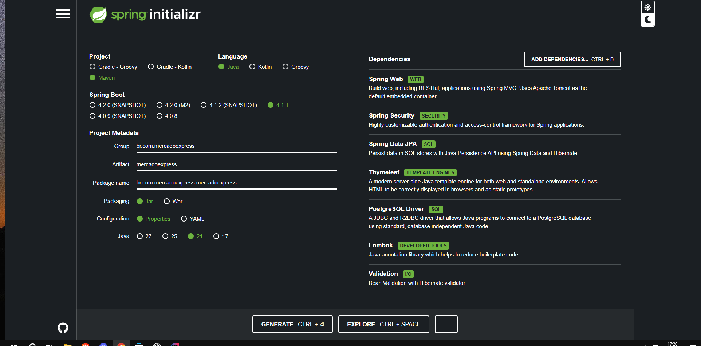
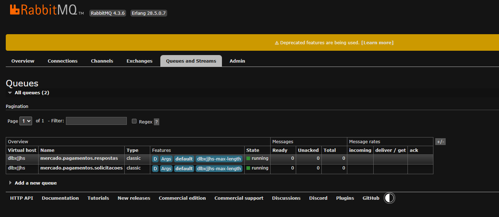
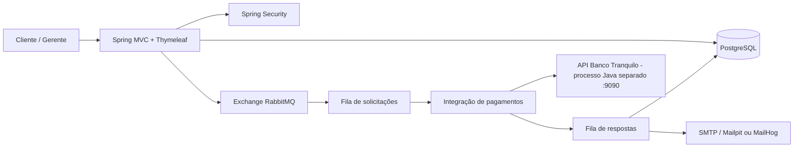

# Mercado Express - CP5 Java Advanced

**Aluna:** Amandha Yumi Toyota Artulino - **RM:** 563549 - **Turma:** 2TDSPO.

**Repositorio:** https://github.com/AmandhaYumi/Cp-Java

Aplicação full stack em Java 21 que reúne as duas partes do Checkpoint 5: um e-commerce MVC protegido com Spring Security e um fluxo de pagamentos assíncrono com RabbitMQ, API do Banco Tranquilo, e-mail e dashboard gerencial.



## Evidencia do RabbitMQ na nuvem



Print fornecido durante a configuracao da instancia: as filas `mercado.pagamentos.solicitacoes` e `mercado.pagamentos.respostas` estao em execucao. A contagem zero representa o estado daquela captura; a comprovacao do processamento exige o teste de compra descrito abaixo.

## Funcionalidades entregues

### Parte 1 - Spring Security MVC

- Landing page obrigatória em `index.html`.
- Tela de login personalizada e cadastro (Sign Up) persistido em `TDS_USERS_MERCADO`.
- Dois tipos de usuário: `CLIENTE` compra e consulta seus pedidos; `GERENTE` também administra produtos e acessa o dashboard.
- CRUD completo de produtos, na interface e na API, com exclusão lógica.
- PostgreSQL e tabela principal `TDS_SEC_MVC_TB_MERCADO`.
- Validação de formulários, senhas BCrypt, CSRF nas telas e autorização por rota.
- Dockerfile, health check e modelo `render.yaml` para deploy no Render.

### Parte 2 - Mensageria e integração

- Carrinho e checkout com reserva de estoque.
- Exchange direta `mercado.pagamentos.exchange`.
- Fila de solicitações `mercado.pagamentos.solicitacoes` e fila de respostas `mercado.pagamentos.respostas`.
- Cliente HTTP para a API do Banco Tranquilo e endpoint simulador reproduzível.
- Confirmação por e-mail após pagamento aprovado; todo envio é auditado em `TDS_EMAIL_LOG_MERCADO`.
- Compras e itens persistidos em `TDS_COMPRAS_MERCADO` e `TDS_ITENS_COMPRA_MERCADO`.
- Dashboard com vendas, receita, lucro, estoque, e-mails e gráfico por categoria.
- Coleção Postman com CRUD, checkout e simulação bancária.

## Arquitetura



O ambiente completo executa a aplicacao MVC e o simulador `banco-tranquilo/` como dois servicos Java independentes. O simulador e educacional: nao movimenta dinheiro e deve receber somente numeros ficticios de cartao. O perfil `demo` isolado mantem um simulador embarcado para uma apresentacao simplificada, sem RabbitMQ.

## Tecnologias

Java 21, Spring Boot 4.1.1, Spring MVC, Spring Security, Spring Data JPA, Thymeleaf, Validation, RabbitMQ, PostgreSQL, Java Mail, Lombok, Maven, Docker e H2 apenas para testes/demonstração local.

## Executar a solução completa

Pré-requisito: Docker Desktop em execução.

```bash
docker compose up --build
```

Serviços disponíveis:

| Serviço | Endereço | Credenciais |
|---|---|---|
| Aplicação | http://localhost:8080 | veja usuários abaixo |
| RabbitMQ Management | http://localhost:15672 | `mercadoexpress` / `mercadoexpress` |
| MailHog | http://localhost:8025 | sem login |
| PostgreSQL | `localhost:5432/mercadoexpress` | `mercadoexpress` / `mercadoexpress` |
| Banco Tranquilo separado | http://localhost:9090/actuator/health | simulador sem login |

Para encerrar:

```bash
docker compose down
```

Use `docker compose down -v` somente se desejar apagar também os dados do banco.

## Execução rápida sem Docker

**Modo validado nesta maquina: PostgreSQL persistente + RabbitMQ CloudAMQP + Mailpit + Banco Tranquilo separado.** Execute na pasta que contem `pom.xml`:

```powershell
.\INICIAR-LOCAL.ps1
```

Em uma maquina nova, primeiro execute `.\PREPARAR-LOCAL.ps1`, que baixa PostgreSQL e Mailpit dos fornecedores oficiais. Configure sua instancia RabbitMQ em `.secrets/cloudamqp.properties`. O script inicia o PostgreSQL apenas em `127.0.0.1:55432`, o SMTP apenas em `127.0.0.1:1025`, a caixa de e-mails em `http://localhost:8025` e o Banco Tranquilo separado em `http://localhost:9090`. Depois inicia o mercado em `http://localhost:8080`.

Os dados persistem em `.runtime/postgres-data/` e os e-mails em `.runtime/mailpit.db`. A senha do banco local e gerada automaticamente em `.secrets/postgres-password.txt`. Esses arquivos privados nao entram no Git nem no ZIP. Mailpit e uma caixa SMTP de testes: o recebimento e real no servidor local, mas nao ha entrega para Gmail/Outlook.

O fluxo foi validado com aprovacao, recusa, devolucao de estoque, auditoria de e-mail e persistencia apos reinicio. Veja [evidencias de validacao](docs/VALIDACAO.md).

### Alternativa com Docker e RabbitMQ CloudAMQP

Para a demonstracao completa usando seu RabbitMQ CloudAMQP e PostgreSQL persistente, abra o Docker Desktop e execute:

```powershell
.\INICIAR-COMPLETO.ps1
```

Esse comando sobe apenas PostgreSQL e MailHog no Docker, e inicia a aplicacao Java com o perfil `cloud`. O banco persiste no volume Docker `postgres_data`. Acesse `http://localhost:8025` para ler as mensagens capturadas pelo servidor SMTP de teste. MailHog recebe e-mails localmente; nao envia para uma caixa externa.

Para usar a instancia real do CloudAMQP configurada nesta maquina, execute na pasta do projeto:

```powershell
.\INICIAR-CLOUD.ps1
```

O script ativa `demo,cloud`: banco H2 temporario e RabbitMQ real por TLS. Os dados do banco sao apagados ao encerrar; para a entrega, use PostgreSQL com apenas o perfil `cloud`. O envio de e-mail continua exigindo SMTP configurado.

As credenciais ficam em `.secrets/cloudamqp.properties`, ignorado pelo Git e pelo Docker. Esse arquivo nao deve entrar no ZIP de entrega. Em outra maquina, crie-o com suas proprias configuracoes `spring.rabbitmq.host`, `port`, `username`, `password`, `virtual-host` e `ssl.enabled=true`. Nao inclua credenciais no README.

No Windows, a máquina precisa usar o JDK 21. Se `JAVA_HOME` apontar para outra versão:

```powershell
$env:JAVA_HOME='C:\Program Files\Java\jdk-21'
./mvnw.cmd spring-boot:run -Dspring-boot.run.profiles=demo
```

Neste perfil o H2 substitui temporariamente o PostgreSQL, a mensageria é direta e uma falha de SMTP fica registrada como `FALHA` sem impedir a compra.

## Usuários de demonstração

| Perfil | E-mail | Senha | Acesso |
|---|---|---|---|
| Gerente | `gerente@mercadoexpress.com` | `Gerente@123` | CRUD, compras e dashboard |
| Cliente | `cliente@mercadoexpress.com` | `Cliente@123` | catálogo, carrinho e histórico |

Novos cadastros recebem automaticamente o perfil `CLIENTE`. As contas acima são apenas dados de demonstração e devem ter as senhas trocadas em produção.

## Fluxo de compra

1. O usuário autenticado adiciona produtos ao carrinho.
2. O checkout valida e reserva o estoque e grava a compra como `PENDENTE`. Somente depois do commit, publica `PaymentRequestedEvent` para que o consumidor encontre a compra no banco.
3. O consumidor da fila chama `POST /api/banco-tranquilo/pagamentos`.
4. O Banco Tranquilo aprova cartões válidos e recusa números terminados em `0000` (regra de demonstração).
5. A resposta entra na segunda fila; a compra vira `APROVADA` ou `RECUSADA`. Em caso de recusa o estoque é devolvido.
6. Uma aprovação dispara o e-mail e salva o resultado do envio no banco.

## API e Postman

Importe [`postman/Mercado-Express-CP5.postman_collection.json`](postman/Mercado-Express-CP5.postman_collection.json). A API usa autenticação Basic para facilitar a demonstração no Postman.

Exemplo de checkout:

```http
POST /api/purchases
Content-Type: application/json
```

No Postman, selecione **Authorization > Basic Auth**, usuario `cliente@mercadoexpress.com` e senha `Cliente@123`. O Postman gera o cabecalho codificado automaticamente.

```json
{
  "items": [
    {"productId": 1, "quantity": 2},
    {"productId": 3, "quantity": 1}
  ],
  "cardHolder": "CLIENTE DEMO",
  "cardNumber": "4111111111111111"
}
```

Endpoints principais:

| Método | Rota | Regra |
|---|---|---|
| GET | `/products` | catálogo autenticado |
| POST | `/products` | criação pelo gerente |
| POST | `/products/{id}` | atualização pelo gerente |
| POST | `/products/{id}/delete` | exclusão lógica pelo gerente |
| GET | `/api/products` | consulta REST pelo gerente |
| POST/PUT/DELETE | `/api/products` | CRUD REST pelo gerente |
| POST | `/api/purchases` | checkout autenticado |
| POST | `/api/banco-tranquilo/pagamentos` | simulador bancário público para integração |
| GET | `/admin/dashboard` | somente gerente |

## Banco de dados

As credenciais são configuradas por variáveis de ambiente; nenhuma senha real fica versionada. Consulte `.env.example`.

| Tabela | Finalidade |
|---|---|
| `TDS_USERS_MERCADO` | perfis e credenciais criptografadas |
| `TDS_SEC_MVC_TB_MERCADO` | catálogo e estoque |
| `TDS_COMPRAS_MERCADO` | cabeçalho, totais e status do pagamento |
| `TDS_ITENS_COMPRA_MERCADO` | itens e valores históricos |
| `TDS_EMAIL_LOG_MERCADO` | auditoria de envio de e-mails |

O Hibernate cria/atualiza o esquema com `ddl-auto: update`. Para uma evolução de produção, o próximo passo seria versionar o esquema com Flyway.

## Testes e build

```powershell
$env:JAVA_HOME='C:\Program Files\Java\jdk-21'
./mvnw.cmd test
./mvnw.cmd clean package
```

O teste de contexto usa o perfil `test` e banco H2 isolado, portanto não depende do PostgreSQL nem do RabbitMQ.

Ha tambem tres testes de integracao de checkout: aprovacao e e-mail persistidos apos commit, recusa com devolucao de estoque, e rejeicao de estoque insuficiente sem chamar o banco.

Para repetir a verificacao com PostgreSQL, RabbitMQ real, servico bancario e SMTP locais em execucao:

```powershell
.\scripts\TESTAR-INTEGRACAO.ps1
```

O script cria um produto de teste, atualiza, efetua uma compra aprovada e outra recusada, verifica o e-mail e o estoque, testa o acesso do cliente ao dashboard e exclui logicamente o produto de teste. O historico de compras de teste e mantido.

## Deploy no Render

1. Publique o repositório no GitHub.
2. No Render, crie um Blueprint usando `render.yaml`.
3. Preencha os campos privados `RABBITMQ_HOST`, `RABBITMQ_USERNAME`, `RABBITMQ_PASSWORD` e `RABBITMQ_VHOST` com os dados da instancia CloudAMQP. A porta 5671 e TLS ja estao configurados no blueprint.
4. Preencha os campos `MAIL_*` com seu provedor SMTP. O MailHog local nao esta disponivel no Render.
5. O blueprint monta uma URL JDBC com o host e nome do banco gerenciado. `BANK_API_URL` usa o simulador bancario dentro do proprio container na porta padrao 10000 do Render; se mudar `PORT`, ajuste a URL tambem.

O blueprint ativa a mensageria e exige um broker externo e SMTP configurados. O arquivo e uma preparacao de deploy: publicar efetivamente depende de conectar o repositorio e informar esses dados na conta Render. As credenciais locais de `.secrets/` nao sao publicadas.

## Material de entrega

- `entrega.txt`: completar turma, nomes, RMs, links do GitHub, deploy e vídeo.
- `ROTEIRO-VIDEO.md`: roteiro de 5 a 7 minutos cobrindo todos os itens pedidos.
- `postman/`: coleção pronta para importação.
- `docs/spring-initializr.png`: print obrigatório das dependências.
- `docs/rabbitmq-filas.png`: print real fornecido pelo aluno, incluido neste README.
- `docs/VALIDACAO.md`: resultados e limites dos testes executados.

Antes de enviar, acrescente os demais prints (landing page, login, cadastro, CRUD, caixa de e-mail e dashboard); complete todos os campos de `entrega.txt`; grave o video; confirme o acesso publico nao listado; e atualize o ZIP sem `target/`, `.runtime/`, `.secrets/`, `.idea/` e `.env`.
